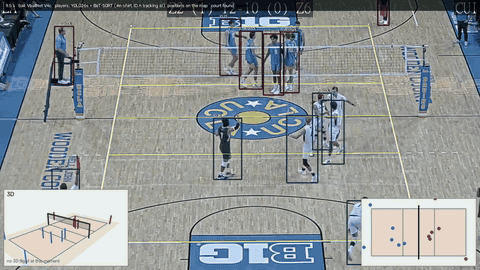
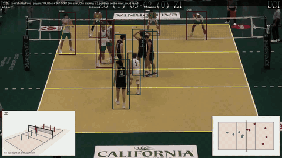
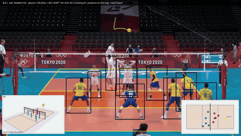
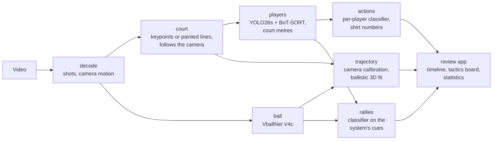
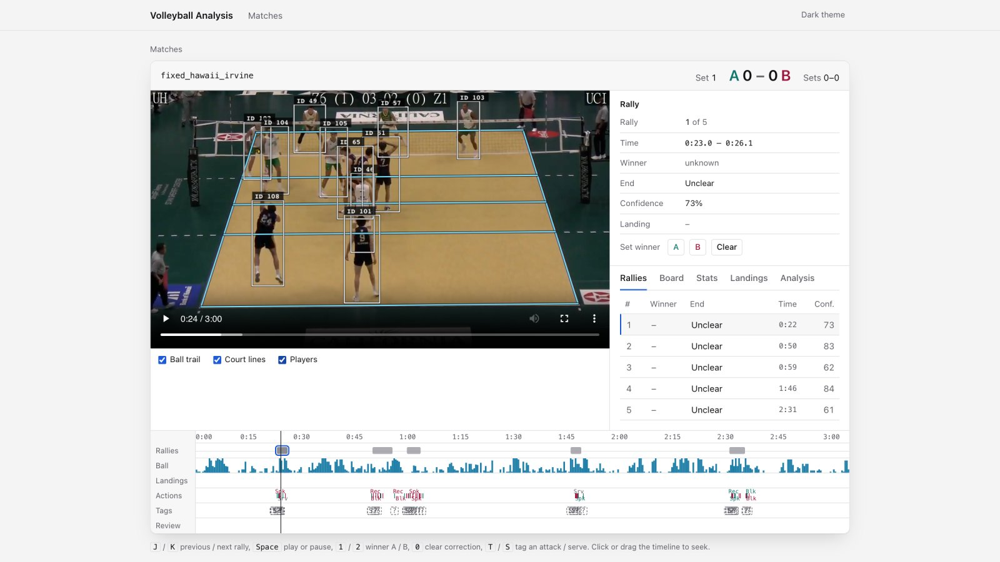
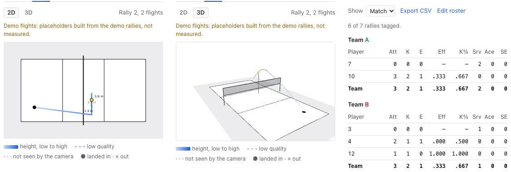

# Volleyball Match Analysis from a Single Camera

**基於深度學習的排球比賽分析系統** · NTOU CSE senior capstone, continued as a research project

Turning one camera's recording of a volleyball match into a reviewable, point-by-point record: the ball's path,
the court in metres, the players, rallies and the score.

[](https://github.com/DL-Volleyball-Analysis/volleyball-analysis/actions)
[](https://dl-volleyball-analysis.github.io/volleyvision-website/)
[](https://github.com/DL-Volleyball-Analysis/capstone-report)
[](LICENSE)

<p align="center">
  
  <br><sub>Output of <code>vball_app.render</code> on a fixed end-line camera (GCU vs UCLA): the court fitted
  to the painted lines of an empty-court background plate (here the volleyball lines are black and the basketball
  lines white; both keypoint models fail on this view), players tracked with YOLO26s + BoT-SORT and coloured by side,
  the ball trail (VballNet), a top-down map and a 3D view with the current 3D flight. On this clip 108 flights are
  kept (36 rejected as impossible), and the fixed-camera rally model, trained on other matches, finds 11 of the 13
  points shown by the score bug.</sub>
</p>

| Floor with basketball lines (UCLA) | Most accurate court lines (Hawaii) | Broadcast view (Tokyo 2020) |
|:---:|:---:|:---:|
|  |  |  |
| fewest rejected 3D flights of the fixed clips (17%) | 94% of court-line samples on painted lines | 12 3D flights, none rejected |

<sub>All footage used for research only: NCAA men's volleyball (VolleyballWatchdog) and a Volleyball World broadcast.</sub>

## Pipeline



Each stage is versioned and cached, reports why it could not produce a result (no usable court, camera not
calibrated, model missing), and later stages only use results marked reliable.

## Results

Every number comes from a script and a labelled split, or is named a proxy or synthetic. Details and scripts:
[docs/results/](docs/results).

| Component | Result | Evidence |
|---|---|---|
| Court registration | 0.10 m median court-position error on held-out broadcast clips (96% within 0.3 m); 0.49 m on held-out gym images. Fixed end-line cameras, where both keypoint models fail: the court fitted to the painted lines of an empty-court background plate is measured on hand-labelled floor points: five of six clips right to 0.02-0.06 m (median), one (Quincy) wrong by 1.06 m, stretched in depth. The net tape gives the focal length for 3D. | labelled test images; labelled floor points · [court-keypoints.md](docs/results/court-keypoints.md) |
| Moving cameras | Frame-to-frame camera motion from the video (keyframe registration): the court, user corrections and 3D follow pans and zooms; a still camera stays still. | photometric check · [moving-camera.md](docs/prd/moving-camera.md) |
| Player tracking | IDF1 0.690, HOTA 0.636, precision 0.970 on SportsMOT volleyball with a detector fine-tuned to box players only (no referees, line judges or spectators). | labelled benchmark · [player-tracking.md](docs/results/player-tracking.md) |
| Ball tracking | VballNet V4c in the pipeline: 3.08 false jumps per 100 frames, 68.7% of frames detected on 5 broadcast clips. WASB fine-tuned on broadcast + gym data: F1 0.942 (10 px) on held-out gym matches, against 0.859 for VballNet and 0.527 for WASB's published weights; its broadcast test is pending before it replaces VballNet. | labelled test matches · [ball-tracking.md](docs/results/ball-tracking.md) |
| 3D trajectory | Robust, bounded ballistic fit anchored to the touching player: attack error 0.76 -> 0.31 m (median) on synthetic rallies with 30% missed and 12% false detections when the toucher is unambiguous. A stress test with twelve players shows a wrong anchor makes the attack five times worse, so a touch is anchored only when one player is clearly nearest (never worse than no anchor). On the six fixed clips 45-160 flights per 3 minutes are kept, 25-66% more rejected as impossible (system checks, not accuracy); the 2D ball track is the bottleneck. | synthetic + system checks · [trajectory.md](docs/results/trajectory.md) |
| Action recognition | Per-player classifier (YOLO26s-cls on player crops) weighted by the ball's position: macro F1 0.678 for block / receive / set / spike on 16 unseen matches of the Volleyball dataset, against 0.303 for the capstone's YOLOv11m detector (which fails on set and receive there); 9-class person action accuracy 72.8%. Serves still come from the detector. | labelled benchmark · [actions.md](docs/results/actions.md) |
| Shirt numbers | In the pipeline, voted per player over time. Digit mAP@0.5 0.824 on matches whose teams the model never saw; whole numbers read exactly from 63% of single crops. | labelled test split · [actions.md](docs/results/actions.md) |
| Rally detection | Classifier on the system's own cues (court, players, ball): F1 0.742 at temporal IoU 0.5 on two held-out broadcast matches (220 rallies), against 0.423 for a ball-only rule. It does not transfer to fixed end-line cameras, so a second model is trained on three full fixed-camera matches labelled from the on-screen score (405 points): F1 0.76 on the six fixed clips (80 points, other matches; most share arenas with training). | labelled matches · [rallies.md](docs/results/rallies.md) |
| Player statistics | Attack efficiency, kill rate, aces and serve errors per player from coach tags, CSV export. | tests · [player-stats.md](docs/prd/player-stats.md) |
| Speed | A 3-minute fixed-camera clip in 19 minutes on a laptop CPU (court stage 3.7x and 3D 4.6x faster for still cameras). | measured · [analysis-speed.md](docs/results/analysis-speed.md) |

## Review app



<sub>Match review (React + FastAPI, <a href="webapp/README.md">webapp/</a>) on a fixed end-line clip: the court
fitted to the painted lines and the tracked players on the video, rally details and list, timeline lanes for rallies,
ball, actions and tags. The 13 rallies come from the fixed-camera rally model (12 of the score bug's 14 points
matched). Footage: NCAA men's volleyball (VolleyballWatchdog), research use.</sub>



<sub>2D / 3D tactics board (demo flights) and the player statistics table built from coach tags.</sub>

## How the work is planned
- [docs/architecture.md](docs/architecture.md): components, the staged pipeline and its contract, with the decisions behind them in [docs/adr/](docs/adr/README.md).
- [docs/prd/](docs/prd/README.md): product requirements — why, for whom, what counts as success.
- [openspec/specs/](openspec/specs): how the system behaves today (behaviour contracts).
- [openspec/changes/](openspec/changes): each change's proposal, spec deltas, design and task list.
- [docs/results/](docs/results): measurements behind every number.

## Layout
```
src/vball/          analysis package
  paths.py            project locations and model registry
  ball.py             VballNet ONNX ball tracking (wraps the upstream inference script)
  court.py            court model (18 x 9 m) and homography helpers
  court_keypoints.py  14-point court keypoint layout, flip index, label completion
  players.py          player detection + tracking with interpolation
  calibration.py      camera focal length and pose from court + net keypoints
  trajectory/         flights between touches, ballistic 3D fit, synthetic rallies
  scoring.py          rally winners -> running score (indoor set rules)
  stats.py            attack / serve tags -> outcomes and player statistics
  metrics.py          ball-track metrics (label-free proxies + labelled F1)
  ball_detect.py      ball candidates: VballNet (whole frame / tiles), RAVEL-VB
  ball_track.py       ball tracker: fixed objects dropped, Viterbi linking, gap filling
  actions.py          action detections -> events per player track
  actors.py           per-player action classifier input and the ball prior
  jersey.py           shirt numbers: digit readings voted over time
  teams.py            team and role from torso colours
  rallies.py          rally segmentation, the rally classifier and boundary evaluation
  rally_cues.py       per-sample rally cues (court, players, ball) for training and the pipeline
  court_registration.py  per-shot court mapping, model pick, line evidence, user corrections
  court_lines.py      court fitted to painted lines (background plate), focal length from the net tape
  camera_motion.py    frame-to-frame camera motion (keyframe registration)
  scorebug.py         point changes read from the on-screen score (rally and point-winner labels)
  pipeline/           the staged analysis: one module per stage, model adapters, results folder
scripts/            entry points (dataset build, evaluation, comparisons)
webapp/             web app: package vball_app (backend/: API, worker, render), React UI (frontend/); see webapp/README.md
training/           training code: ball detector (WASB), action recognition, jersey numbers
notebooks/          Kaggle / Colab notebooks (GPU work runs there, never locally)
tests/              pytest for vball (the web app's tests are in webapp/backend/tests)
docs/               PRD (prd/), measured results (results/), design notes
openspec/           specifications and changes
```

Not in git (local only):
```
models/             weights the code loads by name (src/vball/paths.py, src/vball/pipeline/config.py)
data/videos/        test videos; fixed/ holds fixed end-line camera clips (VolleyballWatchdog, kept local, never redistributed)
data/datasets/      public datasets as downloaded + the training sets built from them by scripts/build_*.py
outputs/<topic>/    results of scripts and notebooks, one folder per topic:
                      ball/ court/ players/ actions/ rallies/ videos/ (rendered analyses)
external/           third-party repositories, untouched
```
A new result goes to `outputs/<topic>/<experiment>/`; a number worth keeping is written up in `docs/results/`.

## Setup
```
python3.14 -m venv .venv
.venv/bin/python -m pip install -r requirements/lock.txt && .venv/bin/python -m pip install -e ".[ml]" -e webapp/backend
```
Development workflow, checks and conventions: [CONTRIBUTING.md](CONTRIBUTING.md).
Ball tracking needs [fast-volleyball-tracking-inference](https://github.com/asigatchov/fast-volleyball-tracking-inference)
(MIT) cloned into `external/`; player-tracking evaluation needs
[TrackEval](https://github.com/JonathonLuiten/TrackEval) (MIT) there too.

## Run
```
.venv/bin/python scripts/compare_ball_models.py                     # ball model comparison
.venv/bin/python scripts/download_datasets.py                       # court keypoint data (ROBOFLOW_API_KEY)
.venv/bin/python scripts/inspect_court_keypoints.py data/datasets/<set>
.venv/bin/python scripts/build_court_dataset.py --no-drive          # dataset zip for Colab
.venv/bin/python scripts/eval_player_tracking.py --gt-as-tracker    # tracking evaluation sanity check
.venv/bin/python scripts/eval_trajectory_synthetic.py              # 3D fit on synthetic rallies
.venv/bin/python -m pytest                                          # vball and web app suites, with coverage: --cov
```

## Data and licences
- Code: MIT.
- VballNet models: asigatchov/fast-volleyball-tracking-inference (MIT).
- Court keypoint data: Roboflow Universe volleyball court keypoint sets (CC BY 4.0).
- SportsMOT (player tracking evaluation): CC BY-NC 4.0, research use only, not redistributed.

## Team
Liang Yu-Jia 梁祐嘉 (lead), Tsai Pei-Ying 蔡佩穎, Chung Chia-Hsin 鍾佳芯; advisor Professor Ting Pei-Yi 丁培毅.
Department of Computer Science and Engineering, National Taiwan Ocean University. The rebuild after the capstone
is by Liang Yu-Jia.

## Citation
```bibtex
@misc{liang2026volleyball,
  title  = {Volleyball Match Analysis System Based on Deep Learning},
  author = {Liang, Yu-Jia and Tsai, Pei-Ying and Chung, Chia-Hsin},
  note   = {Senior capstone, Department of Computer Science and Engineering, National Taiwan Ocean University. Advisor: Pei-Yi Ting},
  year   = {2026},
  url    = {https://github.com/DL-Volleyball-Analysis/volleyball-analysis}
}
```
