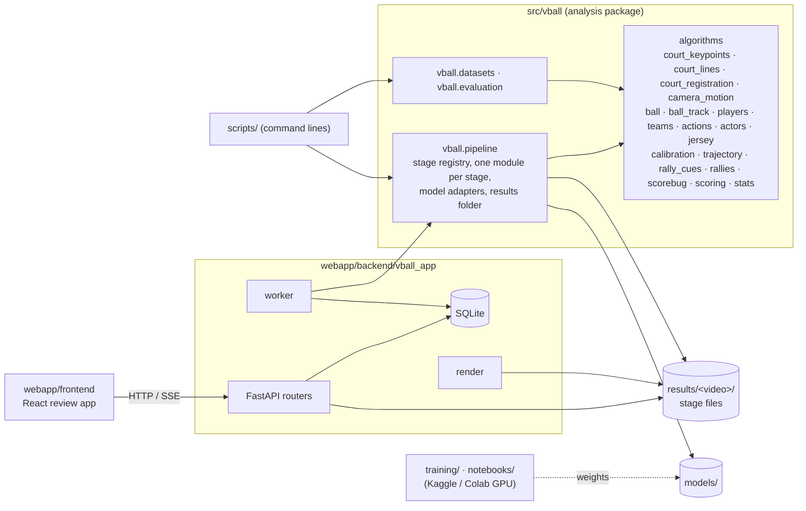

# Architecture

Single-camera volleyball analysis: a video goes in, and a point-by-point record comes out (court, ball, players,
actions, 3D ball flights, rallies), reviewed and corrected in a web app. Single user, runs on the user's own computer
([ADR: single-user local deployment](adr/single-user-local-deployment.md)).

## Components

| Component | Owns | Does not |
|---|---|---|
| `vball` algorithms | geometry, detection post-processing, fitting, segmentation; pure functions on arrays and data frames | read the database, know about HTTP |
| `vball.pipeline` | the order of the stages, their versions and caching, the files in a results folder, loading trained weights (`models.py`) | hold user corrections (it receives them as a callable) |
| `vball.datasets`, `vball.evaluation` | building training sets, measuring on labelled data | run in the app |
| `vball_app` | uploads, the job queue, user corrections, API schemas, the rendered video | contain analysis code |
| frontend | review, correction and tagging UI; types generated from the OpenAPI schema | compute results |
| `scripts/` | argument parsing | contain logic a test or another script uses |

Details of the API, the database tables and the frontend: [webapp/docs/architecture/ARCHITECTURE.md](../webapp/docs/architecture/ARCHITECTURE.md).

## The staged pipeline
`decode → court → ball → players → actions → trajectory → events → rallies`
([ADR: staged, versioned, cached pipeline](adr/staged-cached-pipeline.md)).

| Stage | Reads | Writes (besides `<stage>.json`) | Code |
|---|---|---|---|
| decode | video | camera shots, `camera_motion.npz` | `stages/decode.py`, `vball.camera_motion` |
| court | video, shots, motion | per-shot court samples and status | `stages/court.py`, `vball.court_registration`, `vball.court_lines` |
| ball | video | `ball.csv` | `stages/ball.py`, `vball.ball` |
| players | video, court | `players.csv.gz` (boxes, tracks, court positions, team, role) | `stages/players.py`, `vball.players`, `vball.teams` |
| actions | video, players, ball | `action_events.json` (events per track, shirt numbers) | `stages/actions.py`, `vball.actors`, `vball.jersey` |
| trajectory | court, ball, players, motion | `flights.json` (3D ballistic flights) | `stages/trajectory.py`, `vball.calibration`, `vball.trajectory` |
| events | — | — | not built yet |
| rallies | video (cues) | rallies (written to the database by the worker) | `stages/rallies.py`, `vball.rallies`, `vball.rally_cues` |

**Stage contract.** Each stage module exposes `run(video, out, prev, tick) -> dict`: `out` is the video's results
folder, `prev` the earlier stages' results, `tick(fraction)` reports progress. The result has a `status`:

- `done`, with a summary and, when something is partial, a `message`;
- `unavailable`, when the stage cannot answer on this footage (no model installed, footage outside what a model was
  trained on), always with a `message` saying why.

Messages are shown to coaches as they are, so they say what happened in plain words. A stage never returns a guess
it knows to be unfounded: "the court was not found" rather than a wrong court.

**Versions and caching.** `pipeline.VERSIONS` gives each stage a version; a run reuses a cached stage result whose
version matches and recomputes from the first stage that changed or was asked for. A new court model therefore does
not redo ball tracking.

**User corrections** (court per camera shot, rally winners, tags) live in the app's database and are never written
into stage files. The pipeline receives court corrections as a callable and overlays them where later stages read the
court; a correction triggers a rerun from `players`.

**Model adapters.** Every place that loads trained weights is a function in `vball.pipeline.models`; stages call it as
`models.<name>`, so tests replace it with a fake and no test needs weights.

## Geometry in brief
Court coordinates are metres: x along the 18 m length (net at x = 9), y across the 9 m width, z up. A camera shot's
court is a homography from court to image, from keypoint models or, for still cameras, from the painted lines on a
background plate ([ADR: court from painted lines](adr/court-from-painted-lines.md)). Calibration (focal length, pose)
uses the floor plus the net; on symmetric end-line views the floor cannot fix the focal length and the net tape does
([ADR: focal length from the net tape](adr/focal-length-from-the-net.md)).

## Testing
- **Unit and stage tests** run without weights or videos: synthetic clips, fake adapters, synthetic rallies through a
  known camera (`vball.trajectory.synthetic`). Both suites run in one pytest run with a 90% coverage gate.
- **Refactors** are checked against stored stage outputs of real clips (`scripts/compare_stage_outputs.py`): moving
  the pipeline into its own package left every output identical.
- **Accuracy** is measured on labelled data with matches split between training and test
  ([ADR: evaluation by match](adr/evaluation-by-match.md)) and written up in `docs/results/`.

## Decisions
| ADR | Decision |
|---|---|
| [staged-cached-pipeline](adr/staged-cached-pipeline.md) | analysis as versioned, cached stages with explicit "unavailable" |
| [court-from-painted-lines](adr/court-from-painted-lines.md) | still cameras: fit the court to painted lines on a background plate, no learned model |
| [focal-length-from-the-net](adr/focal-length-from-the-net.md) | symmetric end-line views: focal length from the net tape |
| [evaluation-by-match](adr/evaluation-by-match.md) | training and test data split by match, never by frame |
| [single-user-local-deployment](adr/single-user-local-deployment.md) | one machine, SQLite job queue, no accounts or cloud |
